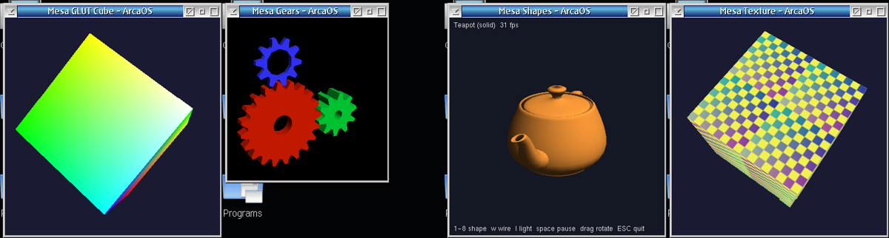
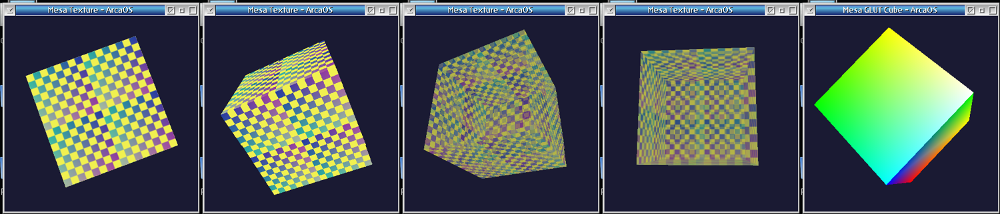
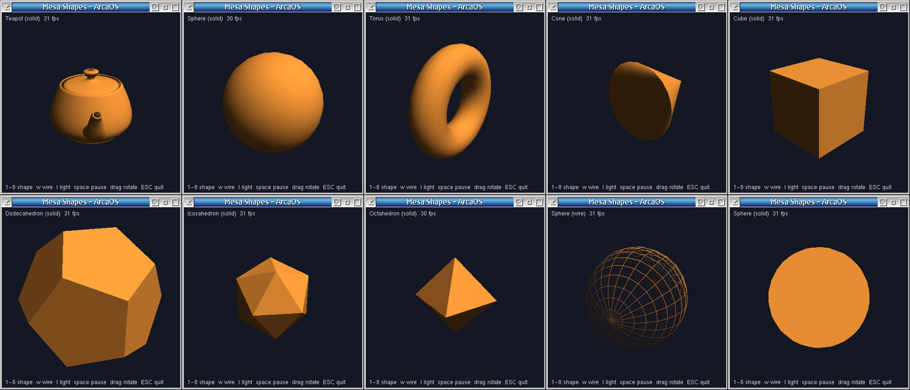

# Mesa 7.11.2 for OS/2 (ArcaOS)

A port of the [Mesa 3D](https://www.mesa3d.org/) graphics library, version 7.11.2, to
**OS/2 Warp / ArcaOS**. It provides the **OpenGL 2.1** API (including the GLSL
compiler), GLU and GLUT for Presentation Manager, built with the GCC 9.2 toolchain
(`i686-pc-os2-emx`, kLIBC). Rendering is done in software by Mesa's classic `swrast`
path into a PM window.



*glutcube, gears, shapes and texture running on ArcaOS 5.1.1.*

## What's included

| DLL | Content |
|---|---|
| `MesaGL7.dll`  | OpenGL 2.1 (Mesa core, software rasteriser, OS/2 PM driver) |
| `libGLU7.dll`  | GLU (SGI GLU, with NURBS) |
| `libGLUT7.dll` | GLUT for Presentation Manager (single window) |

Plus GCC import libraries (`lib/*_imp.a`), the headers (`gl.h`, `glu.h`, `glut.h`,
`glext.h`) and four demo programs with source:

* **glutcube** - smooth-shaded rotating cube
* **gears** - the classic three gears (lighting, display lists)
* **shapes** - the eight GLUT solids and wireframes, lighting toggle, mouse drag,
  bitmap-font overlay
* **texture** - texture mapping with mipmaps, filtering modes and alpha blending

Programs link to the DLLs at load time, so they appear as normal imports in PMDLL.



## Download

Prebuilt packages are on the [Releases](../../releases) page:

* `Mesa-7.11.2-os2-1.0-bin.zip` - DLLs, import libraries, headers, demo executables
* `Mesa-7.11.2-os2-1.0-src.zip` - cleaned source tree

## Quick start

1. Unzip the binary package.
2. Put `MesaGL7.dll`, `libGLU7.dll` and `libGLUT7.dll` on your `LIBPATH`
   (or next to your executable). The `demos` folder already has them next to the
   exes, so you can just run `gears.exe`.
3. To build your own program with GCC:

```
gcc -Wall -O2 -fno-builtin-sinf -fno-builtin-cosf -fno-builtin-sin -fno-builtin-cos \
    -Zomf -Iinclude -c myprog.c
gcc -Zomf -o myprog.exe myprog.def myprog.o \
    lib/libGLUT7_imp.a lib/MesaGL7_imp.a lib/libGLU7_imp.a -lm
```

`myprog.def` needs `NAME MYPROG WINDOWAPI` so the exe is a PM application.

> **Compiler flags matter.** At `-O2` GCC merges `sinf(a)` + `cosf(a)` into a call to
> `cexpf()`, and the OS/2 libm returns NaN for it, so geometry silently disappears.
> Always compile with the `-fno-builtin-sin/cos` flags above. All Mesa libraries in
> this repository are already built that way.

## Building from source

On ArcaOS with `gcc`/`g++` 9.x, GNU `make`, `binutils` (`emximp`, `emxomfld`) and the
OS/2 Toolkit headers installed through ANPM (plus Open Watcom's `wl.exe`, used by
`emxomfld` as the linker):

```
build_dlls.cmd                 :: compile + link all three DLLs and the import libs
demos\build_demos.cmd          :: build gears, shapes, texture
demos\glutcube\compile_glutcube.cmd
```

A full build takes 10-15 minutes. Every script writes a log file next to it. See
[README.os2.md](README.os2.md) for the build details, the link order, the compiler
flags, a troubleshooting table and notes on building in a VM over ssh.

## Status

This is release 1.0 and still young:

* Tested on **ArcaOS 5.1.1 in a VirtualBox VM** (32-bit colour) only - real hardware
  reports are very welcome.
* **Software rendering**; roughly 10 ms of CPU per frame for a 400x400 window in the
  test VM. No DIVE or hardware acceleration.
* GLUT supports **one window**; menus, overlays, game mode and video resize are stubs.
  Idle-driven animation is capped at 30 fps (`GLUT_FPS` environment variable).
* GLSL and the usual Mesa extensions are part of the build but **untested**.
* **Not binary compatible** with the old Mesa 5.0 OS/2 port (`MesaGL2.DLL`);
  programs must be relinked.
* Only **GCC** import libraries are provided (no Open Watcom libraries yet).



## Why Mesa 7.11.2?

It adds OpenGL 2.1 and GLSL while the classic software rasteriser still exists next to
Gallium, and it builds with plain makefiles and GCC - no meson or Python toolchain
needed on ArcaOS. Newer Mesa releases would be a much larger project because of the
build system and dependencies.

## What was changed from upstream

* `src/mesa/main/querymatrix.c`: a one-line guard so it compiles with this libc.
* New: `src/mesa/drivers/os2/` (PM driver and compatibility headers),
  `src/glut/os2/` (PM GLUT), `Makefile.os2*`, the `.def`/`.rsp`/`.cmd` build files,
  `demos/`, `dev/` and the OS/2 documentation.
* Everything else is stock Mesa 7.11.2 (`MesaLib` + `MesaGLUT`).

Platform issues found and handled during the port (details in `README.os2.md`):
unresolved externals when linking DLLs with bare WLINK, the `cexpf` rewrite above,
OS/2's unmasked x87 exceptions (`SIGFPE` in libc, fixed in `glutInit`), and a PM
driver blit that used a released presentation space.

## Contributing

Bug reports and test results are the most useful thing right now: please include your
ArcaOS version, video driver, colour depth and what you ran. Pull requests are
welcome.

## Licence and credits

* **Mesa**: MIT licence (`docs/license.html`, `docs/COPYING`).
* **SGI GLU** (`src/glu/sgi`): SGI Free Software License B.
* **GLUT** (`src/glut/glx`, `include/GL/glut.h`): Mark J. Kilgard's GLUT licence.
* **OS/2 port code and the new demos**: Copyright (c) 2026 Martin Iturbide (OS2World),
  MIT licence. The `gears` demo is a rewrite of Brian Paul's classic Mesa demo.

Thanks to the Mesa developers, to the author of the earlier Mesa 5.0 OS/2 port, and
to the ANPM/ArcaOS maintainers for the GCC toolchain.

OS/2 port by **Martin Iturbide (OS2World)**.
